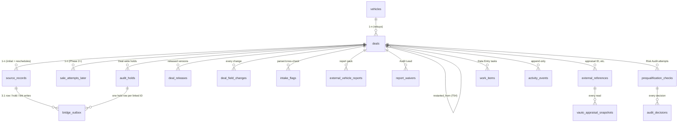

# Interim Inventory Tool — Phase 1a Supabase Schema Design (v0.1, for review)

**Date:** 19 Oct 2026 · **Author:** Claude · **Reviewer:** Codex · **Approver:** Rami
**Status:** Design for review. Nothing has been created in Supabase. No migration, Worker, AppSheet or Base44 work starts until this is reviewed and approved.

**Baseline**
- Interim Inventory Tool Business Analysis v0.2 (approved, rev 40). Decision IDs T1–T58.
- vAuto Unit Intake & Risk Audit Business Analysis v0.3 (approved, rev 138). Decision IDs D1–D25, open-question IDs Q1–Q13.
- Developers' (Liquid Technologies) Full ERD, 120 tables. Column lists are as read from the PDF; see assumption A1.

**In scope (Phase 1a):** vAuto intake, Data Entry, the report pack, Risk Audit with holds, the 3.1 bridge and its outbox, the AppSheet hold and link records, polling and reconciliation, and the activity log.

**Out of scope here:** Worker logic, AppSheet configuration, Base44 screens (each is a later review step), and every module after Phase 1a.

---

## 1. Design principles

1. **Mirror the developers' schema.** Where a developer table fits, use its name and columns unchanged and add only the columns we need. Where none fits, add a new table and mark it **NEW**. Every addition is listed in §9 as a request to put to the developers.
2. **Separate dimensions instead of one status column** (T1, IIT §4). Each of these lives in its own place:
   - intake state
   - Audit decision
   - hold state
   - cancellation
   - bridge state
   - link state
3. **History is never overwritten.** Every decision, field change, hold event, bridge write and report version is a new row. A "current" value on a parent table is only a cache of the latest row.
4. **Append-only is enforced in the database**, not just by convention. App roles get no `UPDATE`/`DELETE` grant on history tables, and a trigger rejects both (§7).
5. **No banned data in structured columns.** There is no column for:
   - the lien account number
   - the customer's home street address
   - bank account numbers

   Original report files may contain account numbers (T43). They live only in Storage, restricted by role.
6. **Idempotent by key.** Every external effect has a unique key, so retries can never duplicate:
   - each Deal creation
   - each 3.1 row
   - each hold or link row
7. **Postgres 15 compatible**, which is Supabase's version. That keeps us inside what both Aurora 15.15 and 16 accept (the developers' docs disagree on which they run).
8. **Conventions:**
   - IDs: `uuid` primary keys from `gen_random_uuid()`.
   - Money: `numeric(14,2)`.
   - Times: `timestamptz`.
   - Statuses: `text` with `CHECK` constraints, not Postgres enums, so values can change cheaply.

---

## 2. Core model at a glance



---

## 3. How the schema supports each required behaviour

| Behaviour | Where it lives | How it is enforced |
|---|---|---|
| **Four-record identity** (T1) | `vehicles` (one row per normalized VIN); `deals` (one purchase episode); `source_records` (each 3.1 row); Sale Attempt deferred to Phase 2 | Unique `vehicles.vin_normalized`. `source_records.deal_id` is NOT NULL once the row is linked. |
| **vAuto appraisal is a reference, not a Source Record** | `external_references` (system `vauto_appraisal`) plus `vauto_appraisal_snapshots` | The appraisal ID is the intake idempotency key (unique per active Deal; see §5.3). A VIN correction changes `vehicles`/`deals` only, never the reference. |
| **One initial 3.1 row per Deal** (T24) | `source_records.kind = 'initial'` | Partial unique index on `(deal_id) WHERE kind='initial'`. Bridge outbox key: `add_row:<deal_id>:initial`. |
| **Reschedule linking** (T2) | `source_records.kind='reschedule'` with `replaces_source_record_id` | A row may link only when the replaced row belongs to the same Deal, is marked Rescheduled and has the same VIN and seller (checked by trigger). Otherwise `link_status='conflict'` and a Data Entry work item is opened. |
| **Restarted purchases** (T54) | `deals.restarted_from_deal_id` (self-reference) | A new Deal that points at a cancelled one. Only one *active* Deal per appraisal ID (partial unique index). A re-completed appraisal on a cancelled Deal raises a `legacy_match` work item and never reopens the old Deal. |
| **Deal-wide holds** (T45, T55) | `audit_holds` (one row per hold, scoped to the Deal) | Opening a hold queues one AppSheet hold row for **every** linked Source Record, plus any linked later while the hold is open (trigger on link). Release adds a release row only for the holds that review covered. |
| **Unlinked rows blocked** (T55, T57) | `source_records.link_status` plus a confirmed AppSheet link row in `bridge_outbox` | The AppSheet gate requires a link row. A row without a confirmed link stays non-actionable. |
| **Hold delivery proof** (T56) | `bridge_outbox.status` (`pending`/`sent`/`uncertain`/`confirmed`) and `verified_at` | Home shows the Deal as held until every hold row is `confirmed` **and** verified by read-back. |
| **Report history** (D13, D25, T51–T52) | `external_vehicle_reports` (extended), `report_waivers`, `report_requirements` | Replacements never overwrite: `replaces_report_id`. Validity is a computed view. Waivers are append-only and carry the Audit Lead's ID. |
| **Re-audit with the same auditor** (T36, T49) | `prequalification_checks` (one row per attempt), `audit_decisions` (every decision) | A new attempt row per resubmission, with `officer_id` copied from the prior attempt. Decisions are append-only. |
| **Material corrections after release** (D21) | `deal_field_changes.is_material` | When a material field changes, a trigger opens an `audit_hold` and a new Pending attempt. |
| **Append-only activity** | `activity_events` (NEW), `status_history` (dev), `audit_decisions`, `deal_field_changes`, `bridge_outbox` events | §7: grants plus a `reject_mutation()` trigger. |
| **Polling completeness** | `poll_checkpoints`, `poll_runs`, `integration_call_logs` (dev) | The checkpoint advances only in the same transaction that marks a run `complete`. |
| **Independent reconciliation and cutover** (T57) | `reconciliation_runs`, `reconciliation_items` (NEW) | Each item must be resolved or left blocking. The gate is not enabled while cutover items are open. |

---

## 4. Mapping to the developers' tables

**Key:**
- **Reuse:** the table is used as-is.
- **Extend:** we add columns.
- **New:** the developers have no equivalent table.
- **Later:** the table exists but is not used in Phase 1a.

| Developer table | Phase 1a use | Change |
|---|---|---|
| `vehicles` | Vehicle record | **Extend:** `vin_normalized` (unique), `make_text`, `model_text`, `series`, `exterior_color`. vAuto gives free text; `model_id` stays nullable until the catalogue mapping exists. |
| `vehicle_makes`, `vehicle_models` | Optional catalogue link | **Reuse** (nullable) |
| `deals` | The Deal | **Extend:** see §5.2 |
| `leads` | Seller/source container | **Reuse, minimal.** One lead per vAuto Deal, `source='vauto'` (see U1) |
| `organizations` | TAV and Brown Fig entities; lienholders; business sellers | **Reuse.** `kind` values: `tav_entity`, `lienholder`, `business_seller` |
| `users`, `roles`, `user_roles`, `staff_profiles` | Staff, roles, Sourcing Specialists and Acquisition Closers | **Reuse.** Plus a NEW `external_user_map` table to resolve vAuto usernames |
| `addresses` | Meeting location (Scheduling-owned) | **Reuse.** No customer home street is stored |
| `external_vehicle_reports` | Report pack | **Extend:** see §5.6 |
| `vehicle_history_findings` | Findings from reports | **Reuse** |
| `files` | Report PDFs in Supabase Storage | **Reuse** |
| `attachment_retention_policy` | 36-month policy for report files | **Reuse.** The retention start comes from `deals.final_closure_at` (T52) |
| `prequalification_checks` | One Risk Audit attempt | **Extend:** `covered_release_no`, `reopened_from_check_id`, `hold_id` (see U3) |
| `prequalification_check_results` | Audit findings per attempt | **Reuse** |
| `reviews`, `review_reasons` | Not used in Phase 1a | Considered and rejected for intake flags: they have no lifecycle per reason (U3) |
| `approvals` | Not used in Phase 1a | Audit decisions use `audit_decisions` (U3) |
| `status_history` | Every status change on any entity | **Reuse.** Made append-only (§7) |
| `audit_logs` | Request and authentication-level events | **Reuse** (system use) |
| `integrations`, `integration_call_logs` | vAuto and AppSheet configuration; every HTTP call | **Reuse** |
| `system_settings` | Shift calendar, overlap seconds, window size | **Reuse** (see U9) |
| `notes` | Not used for vAuto notes | Raw vAuto notes live in `vauto_appraisal_snapshots.payload` |
| `consignments`, `dealers` | Consignment Deals entered manually (D24) | **Reuse** (link from `deals`) |
| `inventory_items`, `auction_listings`, `sales`, `arbitration_cases`, `payments`, `expenses` | Sale Attempt, money, etc. | **Later** |
| `submitted_documents`, `document_types` | Inspection paperwork | **Later** |

**New tables (all marked NEW):**
- `external_references`
- `vauto_appraisal_snapshots`
- `source_records`
- `source_channels`
- `deal_parties`
- `seller_parties`
- `deal_titles`
- `deal_liens`
- `valuations`
- `deal_releases`
- `deal_field_changes`
- `notes_parse_results`
- `intake_flags`
- `report_requirements`
- `report_waivers`
- `audit_decisions`
- `audit_holds`
- `bridge_outbox`
- `work_items`
- `poll_checkpoints`
- `poll_runs`
- `reconciliation_runs`
- `reconciliation_items`
- `activity_events`
- `external_user_map`

---

## 5. Table design

The DDL below is an illustrative sketch for review, not a migration.

### 5.1 Vehicle

```sql
ALTER TABLE vehicles
  ADD COLUMN vin_normalized text GENERATED ALWAYS AS (upper(btrim(vin))) STORED,
  ADD COLUMN make_text text, ADD COLUMN model_text text,
  ADD COLUMN series text, ADD COLUMN exterior_color text;
CREATE UNIQUE INDEX vehicles_vin_normalized_uq ON vehicles (vin_normalized);
-- Original VIN text kept in vin; matching uses vin_normalized (IIT v0.1 §5.4 rule).
```

### 5.2 Deal (developers' `deals` table, extended)

| Column | Status | Purpose |
|---|---|---|
| `purchase_price`, `buyer_id`, `closer_id`, `stage`, `cancelled_at`, `cancellation_reason`, `lead_id`, `vehicle_id` | dev | `buyer_id` = Sourcing Specialist; `closer_id` = Acquisition Closer (T42) |
| `buying_entity_id` | add | → `organizations` (TAV or Brown Fig); stamped at creation, never inferred (T4, D23) |
| `dealer_number` | add | `5411911` or `5521617`, frozen at creation |
| `origin` | add | `vauto_intake` / `manual_consignment` / `manual_exception` (D24) |
| `consignment_id` | add | → `consignments` (manual consignment Deals) |
| `source_channel_id` | add | → `source_channels` (D12, set by Data Entry) |
| `consumer_route` | add | `risk_audit` / `skip_audit` / `hold_in_data_entry`, derived from the channel |
| `deposit_amount` | add | Explicit 0 allowed; NULL means not yet given (T53) |
| `balance`, `balance_owed` | add | Generated: `purchase_price - coalesce(deposit_amount,0)` (D22) |
| `dealer_sold_to`, `dealer_auction_name` | add | Set by Data Entry at first submission (Q4) |
| `intake_status` | add | `new` / `in_review` / `released` / `voided`. Separate from `stage`. |
| `released_at`, `release_no` | add | Cache of the latest `deal_releases` row |
| `audit_status` | add | Cache of the latest `audit_decisions` value: `not_required` / `pending` / `approved` / `changes_required` / `escalated` / `cancelled` (T49) |
| `on_hold` | add | Cache: true when any `audit_holds` row for this Deal is open |
| `restarted_from_deal_id` | add | → `deals` (T54); `CHECK (restarted_from_deal_id <> id)` |
| `final_closure_at` | add | Start of the 3-year retention period (T52) |
| `data_entry_due_at` | add | Creation time plus 4 staffed working hours, computed via the shift calendar (T50) |

```sql
-- One ACTIVE deal per vAuto appraisal (restarts allowed after cancel) — see 5.3
-- Cancel semantics: cancelled_at NOT NULL ⇒ stage = 'cancelled' (CHECK)
ALTER TABLE deals ADD CONSTRAINT deals_cancel_ck
  CHECK ((cancelled_at IS NULL) = (stage <> 'cancelled'));
```

### 5.3 External references and appraisal snapshots (NEW)

```sql
CREATE TABLE external_references (
  id uuid PRIMARY KEY DEFAULT gen_random_uuid(),
  system text NOT NULL CHECK (system IN ('vauto_appraisal','vauto_entity','idms_stock','manheim_account','appsheet_31')),
  external_id text NOT NULL,
  account_context text,            -- e.g. vAuto entityLogicalId, Manheim dealer number
  deal_id uuid REFERENCES deals(id),
  vehicle_id uuid REFERENCES vehicles(id),
  is_active boolean NOT NULL DEFAULT true,   -- false once its Deal is cancelled
  first_seen_at timestamptz NOT NULL DEFAULT now()
);
-- Intake idempotency: one ACTIVE deal per appraisal; a cancelled deal keeps its row (inactive)
CREATE UNIQUE INDEX extref_active_uq ON external_references (system, external_id, coalesce(account_context,''))
  WHERE is_active;

CREATE TABLE vauto_appraisal_snapshots (       -- append-only evidence of every read
  id uuid PRIMARY KEY DEFAULT gen_random_uuid(),
  appraisal_id text NOT NULL,
  external_reference_id uuid REFERENCES external_references(id),
  poll_run_id uuid REFERENCES poll_runs(id),
  is_completed boolean, last_modified timestamptz, created_at_vauto timestamptz,
  payload jsonb NOT NULL,          -- lien.accountNumber stripped BEFORE insert (Worker + CHECK below)
  payload_hash text NOT NULL,
  fetched_at timestamptz NOT NULL DEFAULT now(),
  UNIQUE (appraisal_id, payload_hash),
  CHECK (NOT (payload #> '{financial,lien}' ? 'accountNumber'))
);
```

- A new snapshot is stored only when `payload_hash` changes. The latest snapshot is compared with the Deal to raise change flags (intake trigger step 6).
- When a Deal is cancelled, its `vauto_appraisal` reference becomes `is_active = false`. If the same appraisal is completed again, intake finds no active reference and finds an inactive one pointing at a cancelled Deal, so it opens a `legacy_match` work item instead of creating or reopening anything (T54).

### 5.4 Source Records (NEW): the 3.1 rows

```sql
CREATE TABLE source_records (
  id uuid PRIMARY KEY DEFAULT gen_random_uuid(),
  legacy_iid text UNIQUE,                 -- 3.1 iD; NULL until the bridge write is confirmed
  deal_id uuid REFERENCES deals(id),      -- NULL only while link_status='unlinked'
  kind text NOT NULL CHECK (kind IN ('initial','reschedule','cutover_legacy')),
  replaces_source_record_id uuid REFERENCES source_records(id),
  created_via text NOT NULL CHECK (created_via IN ('bridge','appsheet_reschedule','manual_fallback','cutover')),
  link_status text NOT NULL CHECK (link_status IN ('unlinked','linked','conflict')),
  linked_at timestamptz, linked_by uuid,
  appsheet_link_confirmed_at timestamptz,  -- AppSheet link row confirmed (T55/T57)
  raw jsonb, source_hash text,             -- latest read-back of the row
  first_seen_at timestamptz NOT NULL DEFAULT now(), last_seen_at timestamptz,
  CHECK (link_status <> 'linked' OR deal_id IS NOT NULL),
  CHECK (kind <> 'reschedule' OR replaces_source_record_id IS NOT NULL OR link_status <> 'linked')
);
CREATE UNIQUE INDEX one_initial_row_per_deal ON source_records (deal_id) WHERE kind = 'initial';
```

- **Reschedule link trigger:** before `link_status` is set to `linked` on a `reschedule` row, the trigger checks that the replaced row:
  - has the same `deal_id`;
  - is marked Rescheduled in its `raw`;
  - has the same normalized VIN and the same seller.

  If any check fails, the row is set to `conflict` and a work item is created.
- **Hold propagation trigger:** after a row becomes `linked`, if the Deal has open holds, the trigger queues one `add_hold` outbox row per open hold for this iD (T55).

### 5.5 Seller, title, lien, valuation

| Table | Key columns | Notes |
|---|---|---|
| `seller_parties` (NEW) | `party_type` (person / business), `first_name`, `last_name`, `business_org_id` → organizations, `phone`, `email`, `user_id` → users (nullable; linked if the seller later creates an account, D14) | No home street address. City and state may be kept from the vAuto address text for matching only. |
| `deal_parties` (NEW) | `deal_id`, `party_id`, `role` (`owner` / `co_owner` / `business_seller` / `authorized_signer` / `title_owner`), `ordinal` | Supports two owners and corporate sellers. Seller matching for reschedules uses the `owner` row. |
| `deal_titles` (NEW) | `deal_id` (unique), `custody` (`in_hand` / `held_lien` / `no_title` / `floored`), `title_state` → us_states, `title_number`, `title_miles`, `brand`, `is_tribal` (OK), `current_location`, `received_at` | Custody is kept separate from lien position (Codex finding). |
| `deal_liens` (NEW) | `deal_id`, `position` (`none` / `lien` / `unknown`), `lienholder_org_id`, `lienholder_name_raw`, `lienholder_phone`, `payoff_amount`, `payoff_good_through`, `per_diem`, `source` | **There is no account-number column, by design.** |
| `valuations` (NEW) | `vehicle_id`, `deal_id`, `source` (`mmr` / `vauto`), `value`, `miles`, `as_of` | Append-only |

### 5.6 Data Entry: releases, changes, parser, flags, work items

| Table | Purpose and key rules |
|---|---|
| `deal_releases` (NEW) | `deal_id`, `release_no`, `released_by`, `released_at`, `snapshot jsonb` (the intake values as released). Unique `(deal_id, release_no)`. Append-only. |
| `deal_field_changes` (NEW) | `deal_id`, `field`, `old_value`, `new_value`, `source` (`vauto` / `parser` / `data_entry` / `audit`), `is_material` (price, VIN, owner, lien, title state, per D21), `after_release` bool, `changed_by`, `reason`, `at`. Append-only. A material change after release opens a hold and a new Pending attempt. |
| `notes_parse_results` (NEW) | `snapshot_id`, `label`, `raw_value`, `parsed_value`, `outcome` (`ok` / `missing_required` / `missing_optional` / `unknown_label` / `unparseable` / `mismatch`). Required labels come from the approved template (T53); `missing_optional` never blocks release. |
| `intake_flags` (NEW) | `deal_id`, `code`, `detail`, `blocks_release` bool, `status` (`open` / `resolved` / `accepted`), `resolved_by`, `resolution`, `resolved_at`. Release is blocked while any flag with `blocks_release` is open. |
| `work_items` (NEW) | `deal_id`, `kind` (`failed_write` / `uncertain_write` / `legacy_match` / `link_conflict` / `cancel_31_update` / `reaudit_31_correction` / `cutover_unresolved`), `assigned_role`, `status`, `due_at`, `closed_by`, `closed_at`, `outcome`. Covers D24, T27, T31, T47, T54 and T57. |
| `source_channels` (NEW) | `vauto_source_value` (unique), `route` (`risk_audit` / `skip_audit` / `hold`), `active`. Routing is reference data (D12). |

### 5.7 Report pack

```sql
ALTER TABLE external_vehicle_reports
  ADD COLUMN deal_id uuid REFERENCES deals(id),          -- reports are per purchase (rebuy gets fresh)
  ADD COLUMN report_type text NOT NULL,                  -- ADD_BASIC, ADD_DETAILED, CARFAX, AUTOCHECK, VINAUDIT, FL_DMV, OK_DMV, OPENCORPORATES
  ADD COLUMN acquisition text NOT NULL CHECK (acquisition IN ('manual_upload','api_pull')),
  ADD COLUMN pulled_at timestamptz NOT NULL,             -- date the report was pulled at the provider
  ADD COLUMN uploaded_by uuid,
  ADD COLUMN validation_status text NOT NULL DEFAULT 'pending'
    CHECK (validation_status IN ('pending','valid','rejected')),
  ADD COLUMN rejection_reason text,                      -- wrong VIN/deal, unreadable, incomplete, stale
  ADD COLUMN replaces_report_id uuid REFERENCES external_vehicle_reports(id);
```

- `report_requirements` (NEW) is reference data. Each row is `report_type` plus a condition: `always`, `title_state='FL'`, `title_state='OK' AND NOT is_tribal`, or `corporate` (T51).
- `report_waivers` (NEW) is append-only. Columns: `deal_id`, `report_type`, `waived_by` (must hold the `audit_lead` role, checked by trigger), `reason`, `at` (D25).
- The view `v_deal_report_status` lists, per Deal, each required report type with its status: `valid`, `waived`, `missing`, `stale` or `rejected`. A report is valid only when all of these hold:
  - it matches the Deal's VIN;
  - `validation_status='valid'`;
  - `pulled_at` is on or after the appraisal date, or the Deal's creation date for manual Deals.

  The required set is recomputed whenever owner type or title state changes.

### 5.8 Risk Audit and holds

```sql
ALTER TABLE prequalification_checks             -- one row = one Risk Audit attempt
  ADD COLUMN covered_release_no int NOT NULL,      -- which released version this attempt reviews
  ADD COLUMN reopened_from_check_id uuid REFERENCES prequalification_checks(id);
-- decision column on the dev table becomes a cache of the latest audit_decisions row

CREATE TABLE audit_decisions (                    -- append-only (T49)
  id uuid PRIMARY KEY DEFAULT gen_random_uuid(),
  check_id uuid NOT NULL REFERENCES prequalification_checks(id),
  decision text NOT NULL CHECK (decision IN ('pending','approved','changes_required','escalated','cancelled')),
  decided_by uuid NOT NULL, comments text, decided_at timestamptz NOT NULL DEFAULT now()
);

CREATE TABLE audit_holds (                         -- Deal-wide (T45, T55)
  id uuid PRIMARY KEY DEFAULT gen_random_uuid(),
  deal_id uuid NOT NULL REFERENCES deals(id),
  cause text NOT NULL CHECK (cause IN ('initial_pending','material_change','reaudit','cancel','cutover_unresolved')),
  opened_at timestamptz NOT NULL DEFAULT now(), opened_by uuid,
  covered_by_check_id uuid REFERENCES prequalification_checks(id),  -- the review that can release it
  released_at timestamptz, released_by uuid,
  release_decision_id uuid REFERENCES audit_decisions(id),
  CHECK ((released_at IS NULL) = (release_decision_id IS NULL))
);
```

- **Releasing a hold** sets `released_at` exactly once (a trigger allows only NULL → value). The release must reference an `approved` decision on the check that covers that hold, so re-approval releases only the holds that review covered (T55). An `audit_holds` row is never deleted.
- **Consumer gate:** a consumer Deal is actionable only when all three are true:
  - its `audit_status` is `approved`;
  - it has no open holds;
  - every Source Record of the Deal is `linked` with `appsheet_link_confirmed_at` set.

  The view `v_deal_actionable` exposes this. AppSheet enforces its own copy using the hold and link rows the tool adds.

### 5.9 Bridge outbox: every write to AppSheet (NEW)

```sql
CREATE TABLE bridge_outbox (
  id uuid PRIMARY KEY DEFAULT gen_random_uuid(),
  kind text NOT NULL CHECK (kind IN ('add_31_row','add_hold_row','add_hold_release_row','add_link_row')),
  deal_id uuid NOT NULL REFERENCES deals(id),
  source_record_id uuid REFERENCES source_records(id),
  hold_id uuid REFERENCES audit_holds(id),
  idempotency_key text NOT NULL UNIQUE,   -- e.g. add_31_row:<deal>:initial, add_hold_row:<hold>:<iid>
  payload jsonb NOT NULL,
  status text NOT NULL CHECK (status IN ('pending','sent','uncertain','confirmed','failed','superseded_manual')),
  attempts int NOT NULL DEFAULT 0, last_error text,
  confirmed_external_id text,             -- 3.1 iD or AppSheet row key
  verified_at timestamptz,                -- read-back proved it present (T56)
  created_at timestamptz NOT NULL DEFAULT now(), updated_at timestamptz
);
```

- Status moves only forward: `pending → sent → confirmed | uncertain | failed`. `uncertain` resolves to `confirmed` or `failed` only after an existence check. Manual fallback sets `superseded_manual` and records the 3.1 iD Data Entry entered, so a later retry can never add a second row (T27).
- Every status change is also written to `activity_events`.

### 5.10 Polling, reconciliation and cutover (NEW)

| Table | Key rules |
|---|---|
| `poll_checkpoints` | One row per stream (`new_completed`, `linked_changes`). `checkpoint_at` is updated only in the same transaction that sets the run to `complete`. |
| `poll_runs` | `stream`, `window_start`, `window_end`, `overlap_seconds`, `count_reported`, `records_seen`, `split_depth`, `created`, `updated`, `errors`, `status` (`running` / `complete` / `failed`). A run is complete only when `records_seen = count_reported` for every window. |
| `reconciliation_runs` | `kind` (`daily_vauto` / `daily_31` / `cutover`), `as_of`, `status` |
| `reconciliation_items` | `run_id`, `deal_id`, `source_record_id`, `appraisal_id`, `finding` (`missing_in_tool` / `missing_in_31` / `duplicate` / `unlinked` / `approval_mismatch` / `hold_mismatch`), `status`, `resolved_by`, `resolution`. The cutover gate cannot be enabled while any cutover item is open (T57). |

### 5.11 Activity (NEW, append-only)

```sql
CREATE TABLE activity_events (
  id bigint GENERATED ALWAYS AS IDENTITY PRIMARY KEY,
  deal_id uuid, entity_type text NOT NULL, entity_id uuid,
  action text NOT NULL, before jsonb, after jsonb,
  actor_id uuid, actor_kind text NOT NULL CHECK (actor_kind IN ('user','worker','system')),
  source text NOT NULL,            -- vauto_poll, data_entry_ui, audit_ui, bridge, reconciliation
  occurred_at timestamptz NOT NULL DEFAULT now()
);
CREATE INDEX activity_deal_idx ON activity_events (deal_id, occurred_at);
```

---

## 6. Access control (RLS)

| Role | Can read | Can write |
|---|---|---|
| `worker` (service) | All Phase 1a tables | Snapshots, references, Deals at creation, poll and reconciliation tables, outbox status, activity |
| `data_entry` | Deals, parties, title, lien, reports, flags, work items | Corrections (through functions that write `deal_field_changes`), releases, flag resolution, report uploads, work items |
| `risk_audit` | Same as Data Entry, plus report files | `audit_decisions`, check results |
| `audit_lead` | As `risk_audit` | Plus `report_waivers` |
| `management` | Everything, read-only | — |

- Phone, lien and report files are visible only to the roles above, never on general pages (T43).
- All writes go through `SECURITY DEFINER` functions such as `release_deal()`, `record_decision()`, `open_hold()`, `link_source_record()` and `correct_field()`, which write both the change and its history in one transaction. Base44 never writes tables directly.

## 7. Append-only enforcement

```sql
CREATE FUNCTION reject_mutation() RETURNS trigger LANGUAGE plpgsql AS $$
BEGIN RAISE EXCEPTION 'append-only table %', TG_TABLE_NAME; END $$;
-- Applied BEFORE UPDATE OR DELETE on: activity_events, status_history, audit_decisions,
-- deal_field_changes, deal_releases, vauto_appraisal_snapshots, report_waivers, valuations.
-- audit_holds, bridge_outbox, source_records, work_items: UPDATE allowed only on listed
-- lifecycle columns, forward-only, via a column-guard trigger; DELETE always rejected.
REVOKE UPDATE, DELETE ON <append-only tables> FROM authenticated, anon;
```

## 8. Invariants to test

Per the testing rule, these are tested from the first migration, using SQL tests or pgTAP, run in CI against a Supabase branch.

1. A second `initial` Source Record for the same Deal is rejected.
2. Two active Deals for the same appraisal ID are rejected. A restart after cancellation is allowed and is linked through `restarted_from_deal_id`.
3. A snapshot containing `financial.lien.accountNumber` is rejected.
4. `UPDATE` or `DELETE` on every append-only table raises an error.
5. A reschedule row whose replaced row belongs to another Deal, or has a different VIN or seller, ends in `conflict` with a work item.
6. Linking a row while a hold is open queues a hold row for that iD. Releasing hold A does not release hold B.
7. A material change after release opens a hold and a Pending attempt with the same officer.
8. `v_deal_report_status`:
   - a stale, wrong-VIN or rejected report counts as missing;
   - a waiver by a user without the `audit_lead` role is rejected;
   - the FL, OK and tribal rules are applied (T51).
9. A poll run cannot advance the checkpoint unless every window is complete.
10. An outbox entry whose status is `uncertain` cannot move to `failed` until an existence check has been recorded.
11. `v_deal_actionable` is false while any Source Record is unlinked or its link is not yet confirmed.

## 9. Additions to raise with the developers

Lien details (no account number), title custody and history, external references, the seller profile without a login (plus multiple owners and authorized signers), the legal-entity stamp, valuations, report-pack fields per Deal, and a restart link between Deals. These match the "Change to ask for" column in the intake analysis. Interim-only tables, such as the bridge outbox, AppSheet holds and links, and poll checkpoints, do not need to go to the developers.

---

## 10. Assumptions

| # | Assumption | Effect if wrong |
|---|---|---|
| A1 | The developers' column lists and types are as read from the ERD PDF, which is not machine-readable; types such as `smallint` and `numeric(14,2)` were transcribed | Small adjustments to mirrored columns |
| A2 | Supabase runs Postgres 15; only features valid in both 15 and 16 are used | None expected |
| A3 | `deals.lead_id` may be NOT NULL in the developers' design | We create one minimal lead per Deal (U1) |
| A4 | vAuto usernames can be mapped to staff `users` | Unmapped names raise a Data Entry flag |
| A5 | Base44 reaches Supabase only through backend functions using a service key (T10) | RLS is then enforced inside those functions; see U8 |
| A6 | Report files go in a private Supabase Storage bucket and are served through signed URLs | — |

## 11. Unresolved design choices (for Codex and Rami)

| # | Choice | Options | Recommendation |
|---|---|---|---|
| U1 | Deals require a lead? | (a) Create a minimal `leads` row per Deal; (b) make `lead_id` nullable in the interim | (a): stays faithful to the developers' model |
| U2 | Seller identity | (a) NEW `seller_parties` + `deal_parties`; (b) stretch `users` + `organization_contacts` | (a): sellers without a login must exist (D14); `user_id` links an account later |
| U3 | Risk Audit storage | (a) `prequalification_checks` + NEW `audit_decisions`; (b) generic `reviews` + `approvals` | (a): it is deal-specific and has attempts; confirm with the developers that `prequalification_checks` *is* Risk Audit |
| U4 | Appraisal-to-Deal uniqueness | Partial unique on active references (as above) vs a separate restart table | As above |
| U5 | Schema layout | Everything in `public` with the developers' names vs additions in a separate `interim` schema | `public` plus a documented list of additions: simpler RLS and migration |
| U6 | `deal_number` format | Reuse the 3.1 iD vs a new sequence | New sequence; the 3.1 iD stays on `source_records` |
| U7 | 3.1 payload construction | A view `v_bridge_31_payload` (field-map groups A–D) vs building it in the Worker | A SQL view, so the field map is testable in the database |
| U8 | Who enforces RLS | Base44 with per-user JWTs vs a service key plus function-level checks | Needs a Base44 capability check in the next step |
| U9 | Shift calendar for the 4-hour clock | `system_settings` JSON vs a `shift_calendar` table | A table, so holidays and shift changes are dated |
| U10 | Release snapshot | JSON snapshot vs normalized copies | JSON, with the fields listed in the field map |

## 12. Next review steps (after this design is approved)

1. Migration files and invariant tests (§8).
2. Worker design: polling, the outbox sender, read-back and reconciliation.
3. AppSheet changes: the Audit Holds and link tables, the gate conditions, and the inventory of each Zap's source.
4. Base44 screens and build prompts.
